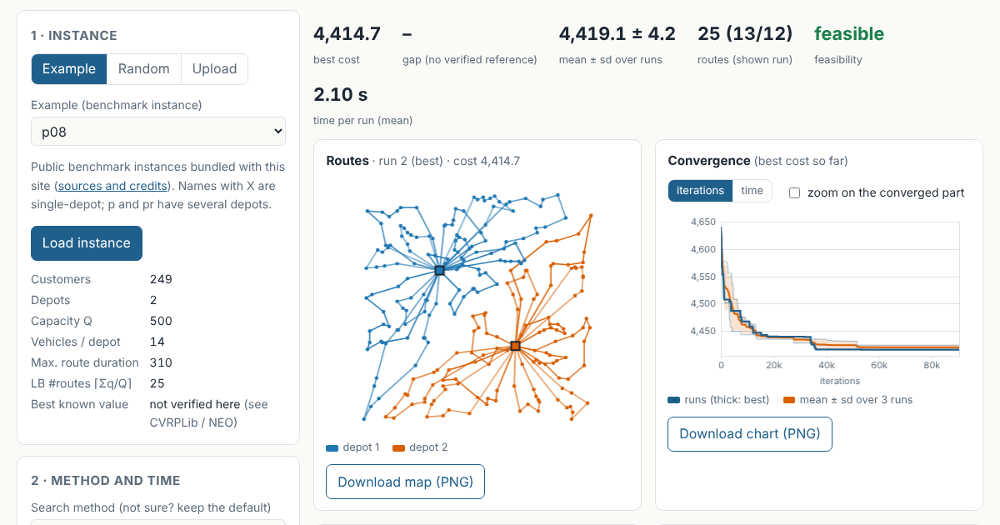

# VRP-Learn

**Plan vehicle routes in your browser, and learn how the methods work.**

[**Open the Solver**](https://michelecedolin.github.io/VRP-Learn/) · [**Open the Learn guide**](https://michelecedolin.github.io/VRP-Learn/learn.html)

[](https://michelecedolin.github.io/VRP-Learn/)

VRP-Learn is a free web application for the capacitated vehicle routing problem with one depot (CVRP) or several depots (MDVRP): a fleet of vehicles starts and ends at the depots, every customer is visited once, and no vehicle exceeds its capacity. Nothing is installed and nothing is uploaded; all computation happens on your device.

## How to use it

1. **Choose the customers**: an example, random customers, or your own table.
2. **Press Solve**: the solver tries several times and keeps improving the routes for a few seconds.
3. **Read the result**: the map of the best routes, the total distance, how fast the cost fell, and how much the tries differ. Download the map (PNG), the best solution or the table of runs (CSV).

**Simple** mode shows only these steps. **Expert** mode adds 20 search methods, an equal-time comparison of several methods, seeds, iteration budgets and local-search operators.

### Your own data

Upload a CSV file with one row per location and a header row:

```csv
name,x,y,demand
Depot,50,50,0
Customer 1,20,70,4
Customer 2,35,90,7
```

* Required columns: `x`, `y`, `demand` (any order; comma, semicolon or tab separated).
* Depots are the rows with demand 0, or the rows marked `depot` in an optional `type` column.
* Type the vehicle capacity on the page, or leave it empty for an automatic value.
* Distances are straight lines in the units of your coordinates.

CVRPLIB `.vrp` files and Cordeau MDVRP files are accepted too.

## What is in the Learn guide

The mathematical models (CVRP and MDVRP), the family of variants, what changes with several depots, construction heuristics, local-search operators with animations, a catalogue of the 20 search methods with their sources, benchmark data sets, open-source solvers, and open research directions. Every citation is listed with its DOI where one could be confirmed ([`references.bib`](references.bib)).

## Scope and limits

The solver is an educational implementation. It is written from the cited papers in a compact form and is not tuned to reproduce published results; for large instances or benchmark-quality solutions use a specialised solver such as HGS-CVRP, PyVRP or FILO (links in the Learn guide). Best-known values are shown only where they could be checked against a published table.

## Repository

```
docs/      the website (GitHub Pages): index.html (Solver), learn.html (Learn), assets/, data/ (bundled examples)
tests/     Node tests of the solver engine, the CSV reader, the bundled examples and the reference list
scripts/   catalogue_site.mjs  (data/catalogue.tsv -> docs/assets/instances.js)
           render_math.mjs     (TeX source of the models -> typeset formulas in docs/learn.html)
data/      catalogue.tsv  (examples, their sources and best-known values)
```

Run the tests with Node 18 or newer: `npm test`. To try the site locally, serve the `docs/` folder with any static web server (for example `npx serve docs`).

The compiled reference implementation that was used to cross-check the solver is not part of this repository.

## Data and credits

The example instances in `docs/data/` are unmodified copies of public benchmark files and keep their original licences; they are not covered by the licence of this repository. See [`docs/data/SOURCES.txt`](docs/data/SOURCES.txt): X instances (Uchoa et al., 2017) from the HGS-CVRP repository (MIT), and the multi-depot instances of Cordeau, Gendreau and Laporte (1997) from STOM-Group/MDVRP-Instances (GPL-2.0).

## Citing

See [`CITATION.cff`](CITATION.cff) (GitHub shows a "Cite this repository" button).

## Licence

MIT for the code and the text of this repository ([LICENSE](LICENSE)); the bundled benchmark files keep their own licences as noted above. The formulas are typeset with [KaTeX](https://katex.org) (MIT), whose style sheet and fonts are bundled in `docs/assets/katex/`.
